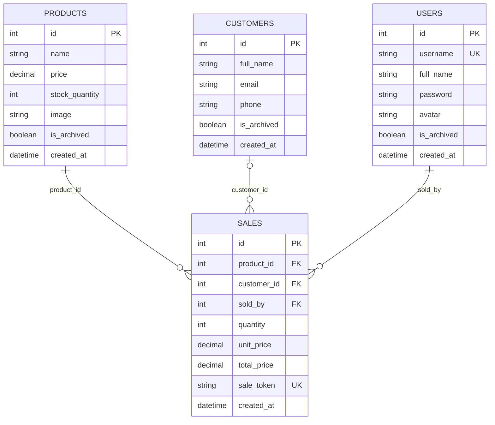

# Counter POS CodeIgniter Midterm Project

IT0049 Complete Point-of-Sale System by Inah Angela Gregorio, BSITCST - AC32.

A CodeIgniter 4 application with product, customer, and staff CRUD; prepared product images and staff avatars; session-based staff authentication; stock-safe sales recording; receipts; and sales history.

Each sale contains one product and a quantity, matching the supplied sales schema. This classroom project does not implement shopping carts, tax calculations, payment processing, or role-based permissions.

## Requirements

PHP 8.2+, Composer 2, intl, mbstring, fileinfo, GD with JPEG/PNG/WebP support, and a database driver. Local setup uses SQLite3. MySQLi is supported through environment configuration and portable CodeIgniter migrations, but the current verification was performed on SQLite.

The Windows run-local.cmd helper enables installed GD and SQLite3 extensions for its child process only. It does not edit XAMPP php.ini or PowerShell execution policy. It creates an ignored .runtime/php directory. Other operating systems should enable these extensions in PHP and run php/composer directly.

## First setup in PowerShell

From the project directory:

```powershell
.\run-local.cmd composer install
if (!(Test-Path .env)) { Copy-Item .env.example .env }
.\run-local.cmd php spark migrate --all
.\run-local.cmd php spark db:seed DemoSeeder
.\run-local.cmd php spark serve --host 127.0.0.1 --port 8010
```

Open http://127.0.0.1:8010/setup. The serve options use spaces before their values.

Choose your own username, full name, and password for the first staff account. Passwords require at least 8 characters and at most 72 bytes. Usernames are normalized to lowercase and allow letters, numbers, dots, underscores, and hyphens. There is no default shared password.

First-staff setup requires pos.allowSetup=true and closes after a staff record exists. Additional staff accounts are created by an authenticated staff member under Staff. For hosting, finish initial setup privately and set pos.allowSetup=false before opening access to others.

Login uses USERNAME and password, not email. On later runs use only the serve command. Keep that PowerShell window open; Ctrl+C stops it. If another instance is already serving port 8010, use it instead of starting a second one.

The seeder adds six fictional products and five fictional customers only when their tables are empty. It creates no staff credentials and no fake sales, and repeating it does not reset edited inventory.

## Pages and workflows

| Page | URL | Access |
| --- | --- | --- |
| First staff setup | /setup | Only with setup enabled and no staff records |
| Login | /login | Public |
| About developer/project | /about | Public |
| Dashboard | / | Authenticated staff |
| Product management | /products | Authenticated staff |
| Customer management | /customers | Authenticated staff |
| Staff management | /staff | Authenticated staff |
| Record Sale | /sales/create | Authenticated staff |
| Sales History | /sales | Authenticated staff |
| Receipt | /sales/{id} | Authenticated staff |
| Prepared image | /media/{kind}/{filename} | Authenticated staff |

Each management list has Add, Edit, and Remove workflows. Removal requires a confirmation checkbox on a dedicated form. Products are archived. Customers and staff used by sales are archived; unused customers and staff are physically deleted. Archived records can be inspected from the Archived records tab and cannot be selected for new sales. Your own signed-in staff account cannot be removed.

Historical sales are never edited or deleted through the application. Names and unit prices are captured when the sale is recorded, so later directory edits do not rewrite receipts.

## Database design

The supplied products, customers, users, and sales tables and all required relationships are retained. Additional archive flags support safe removal. Sales also store unit_price, name snapshots, and a unique sale_token for receipt accuracy and repeat-submission protection.



The migration uses DECIMAL(10,2) for prices and totals, foreign keys for every relationship, and InnoDB when using MySQL. customer_id is nullable for walk-in transactions. Foreign keys prevent deletion of referenced records; application removal archives those records instead.

SQLite is stored at writable/pos.sqlite. To use MySQL, provision a fresh database and configure database.default.DBDriver=MySQLi, hostname, database, username, password, and port through the environment before running migrations. All test results reported here use SQLite; verify your chosen MySQL host before submission.

## Sales and inventory safety

SaleRecorder centralizes the transactional workflow:

1. Check that the product, optional customer, and signed-in staff exist and are active.
2. Read the current product price and available stock.
3. Reject zero, negative, fractional, out-of-stock, or excessive quantities.
4. Calculate money in integer cents, with a check against the DECIMAL(10,2) maximum.
5. Conditionally decrease stock only if enough units are still available and the price is unchanged.
6. Insert the sale with foreign keys, captured names, unit price, and total.
7. Commit both changes together; any failure rolls them back.

A unique form token prevents a repeated successful submission from decrementing stock twice. The server ignores posted totals and staff identities. The actual staff ID comes from the session, and the actual price comes from the database. A stock/price race or database failure rejects the sale cleanly instead of overselling.

The tests include a forced database insert failure to confirm that a prior stock decrement is rolled back.

## Validation and security

- Explicit routes with auto-routing disabled.
- Authentication filter on every management, receipt, and media route.
- The filter verifies the staff record is still active on each request.
- Passwords use password_hash and password_verify; password fields are never prefilled.
- Password values are omitted from preserved form input.
- Session IDs are regenerated on login/setup and sessions are destroyed on logout.
- Login throttling limits repeated attempts.
- CSRF protection is enabled globally using session-based tokens.
- Every write operation is POST and includes a CSRF field.
- Names, contact details, stock, prices, usernames, passwords, and sale quantities are validated.
- User-controlled output is escaped in views.
- Sales remain linked to their source product, customer, and staff records.

All authenticated staff can manage the application, as required by the activity. There are no administrator/cashier privilege tiers.

## Product images and avatars

Only JPEG, PNG, and WebP images up to 2 MB and 4096 by 4096 pixels are accepted. The server inspects actual image data. CodeIgniter's GD image library crops/resizes and re-encodes a display-ready JPEG:

- Products: 640 by 480.
- Staff avatars: 256 by 256.

Generated random filenames are stored under writable/uploads/products or writable/uploads/avatars, outside the document root. Only relative paths are stored in the database. Originals are not retained. Images are served through an authenticated route with a fixed JPEG content type and validated filename. Missing pictures use repository-owned SVG placeholders.

A blank replacement keeps the current image. After a successful record update, an old prepared image is removed. Newly generated files are cleaned up after a failed save. File inputs must be chosen again after a validation error.

## Verification and screenshots

```powershell
.\run-local.cmd php spark migrate:status
.\run-local.cmd php spark routes
.\run-local.cmd php spark pos:summary
.\run-local.cmd php vendor/bin/phpunit
```

The suite uses an isolated in-memory SQLite database. It checks CRUD, hashed passwords, login/logout, setup closure, CSRF rejection, authentication, exact sale totals, customer/walk-in sales, stock reductions, overselling, duplicate submissions, rollback after insert failure, preserved history, and actual prepared image dimensions and formats.

POWERSHELL-GUIDE.txt contains the screenshot sequence, example sales, and captions.

## Code organization

- Controllers: Auth, Dashboard, Products, Customers, Staff, Sales, Media.
- Manage: shared CRUD form/list/removal logic, used by the three management controllers.
- Models: ProductModel, CustomerModel, StaffModel, SaleModel.
- Libraries: SaleRecorder for stock-safe transactions, Money for integer-cent arithmetic, ImageStore for safe prepared uploads.
- Filters: StaffAuth.
- Views: shared layout, reusable management forms, sale form/history/receipt, and authentication pages.
- Database: CreatePosTables migration and DemoSeeder.
- Commands: pos:summary for documentation evidence.

## GitHub upload

Suggested repository: it0049-midterm-codeigniter-pos

Upload the raw project files from Midterm-GitHub-Upload. Include app, public, tests, writable placeholder files, spark, composer.json, composer.lock, phpunit.xml, README, .env.example, and .gitignore.

Exclude .env, real database credentials, vendor, node_modules, .runtime, local SQLite files, logs, sessions, caches, uploaded pictures, and generated test reports. The migration and seeder satisfy the database submission requirement without an export.

The same source is split into smaller numbered folders in Midterm-GitHub-Batches. Upload the CONTENTS of each numbered folder to the SAME repository, committing after every batch. Each batch preserves the original paths; repeated app folders contribute different files to the same app directory. Do not upload the numbered folders themselves.

GitHub's browser uploader does not apply .gitignore exclusions to arbitrary dragged files, so use the prepared folders. Do not upload only a ZIP in place of raw source files.

## Hosting and deployment

Use PHP 8.2+ hosting with Composer, intl, mbstring, fileinfo, GD, and SQLite3 or MySQLi. GitHub Pages does not execute PHP.

Point the document root to public. Install production dependencies with composer install --no-dev --optimize-autoloader. Keep writable accessible to PHP but outside public web access. Provide persistent storage for the SQLite database and prepared pictures. For MySQL, use a fresh host-provided database and private environment credentials.

Set CI_ENVIRONMENT=production, app.baseURL to the real HTTPS URL, app.indexPage empty, and app.appTimezone=Asia/Manila. Enable secure cookies/HTTPS settings for the deployed HTTPS site. Set pos.allowSetup=false after private first-account setup. Configure PHP upload_max_filesize at least 2M and post_max_size larger than the form payload, such as 8M.

Run migrations and DemoSeeder on a fresh database. Create the first staff account during private setup, then close setup. Verify login/logout, prepared image display, one successful sale, overselling rejection, and sales history on the actual host.

A hosted application has not been provisioned here. Submit a real GitHub URL and verified public working HTTPS URL; localhost is for documentation only.

## References

- https://codeigniter4.github.io/userguide/models/model.html
- https://codeigniter4.github.io/userguide/libraries/validation.html
- https://codeigniter4.github.io/userguide/incoming/filters.html
- https://codeigniter4.github.io/userguide/database/transactions.html
- https://codeigniter4.github.io/userguide/libraries/images.html
